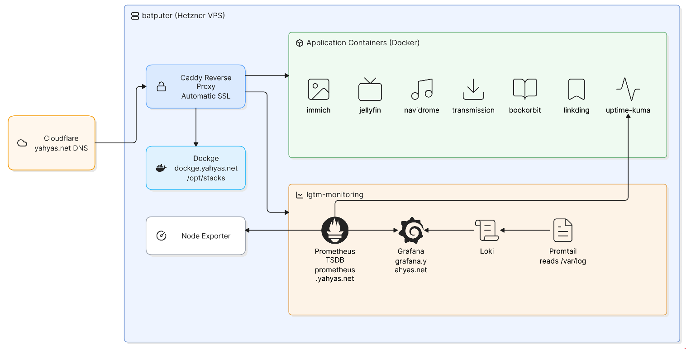
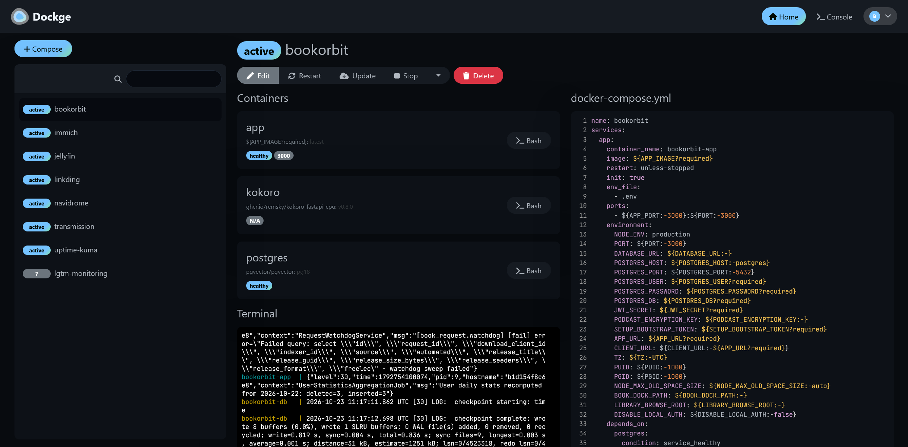
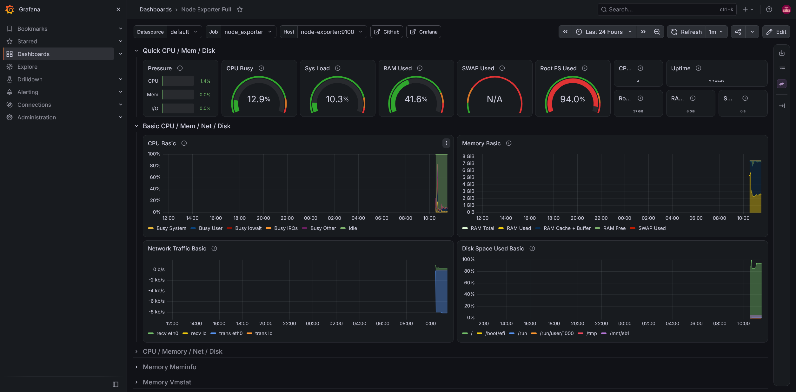
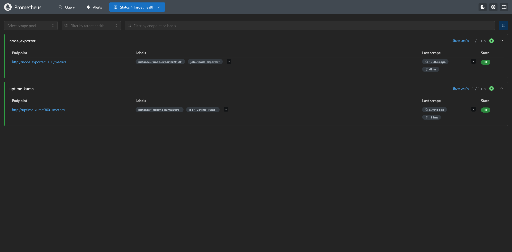
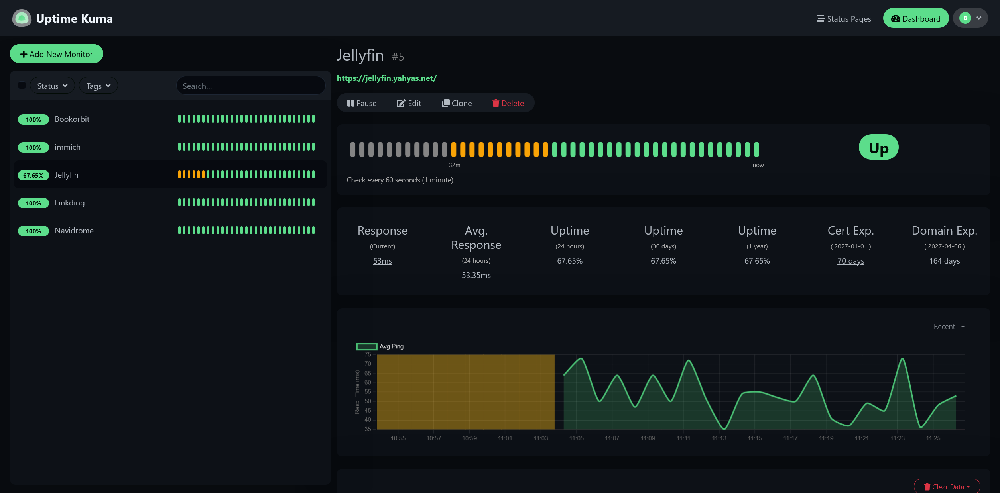

# Self-Hosted Infrastructure

A self-hosted application and monitoring environment running on a Hetzner Ubuntu VPS. Cloudflare provides DNS, Caddy handles public HTTPS ingress, and Docker Compose stacks provide the applications and supporting services.

## Overview

| Component | Role |
| --- | --- |
| **Hetzner VPS — `batputer`** | Ubuntu host for the self-hosted services |
| **Cloudflare DNS** | DNS for the public service hostnames |
| **Caddy** | Reverse proxy, automated SSL termination, and public subdomain routing |
| **Docker Compose** | Runs the application and monitoring stacks |
| **Dockge** | Web-based management for stacks in `/opt/stacks/` |

## System Architecture

 

Cloudflare DNS resolves the public hostnames to the VPS. Caddy provides the HTTPS entry point and routes requests to hosted services. Dockge is available at `dockge.yahyas.net` and manages the Docker Compose stacks stored under `/opt/stacks/`.

## Hosted Stacks

### Applications

| Stack | Description |
| --- | --- |
| `bookorbit` | BookOrbit application |
| `immich` | Immich photo and video management |
| `jellyfin` | Jellyfin media server |
| `linkding` | Linkding bookmark manager |
| `navidrome` | Navidrome music server |
| `transmission` | Transmission |
| `uptime-kuma` | Uptime Kuma service monitoring |

### Monitoring — `lgtm-monitoring`

The monitoring stack includes:

- **Prometheus** for metrics collection and storage
- **Grafana** for monitoring dashboards and visualization
- **Loki** for log aggregation
- **Promtail** for log collection and forwarding
- **Node Exporter** for host-level metrics

## Public Subdomains

| Service | URL |
| --- | --- |
| Dockge | [dockge.yahyas.net](https://dockge.yahyas.net) |
| Grafana | [grafana.yahyas.net](https://grafana.yahyas.net) |
| Prometheus | [prometheus.yahyas.net](https://prometheus.yahyas.net) |

These are the subdomain mappings documented for this deployment. Other hosted services may be routed through Caddy; their public hostnames are not listed here.

## Stack Management

Docker Compose stack files are located in `/opt/stacks/` on `batputer`. Dockge, available at [dockge.yahyas.net](https://dockge.yahyas.net), provides the web interface for managing those stacks.

The repository also contains [`update-all-docker.sh`](./update-all-docker.sh). It runs `docker compose pull` followed by `docker compose up -d` for the application directories listed in the script that exist relative to its current working directory; it skips directories that are not present. The script's list does not include `lgtm-monitoring`.

## Interface Previews

| Dockge | Grafana |
| --- | --- |
|  |  |

| Prometheus | Uptime Kuma |
| --- | --- |
|  |  |
